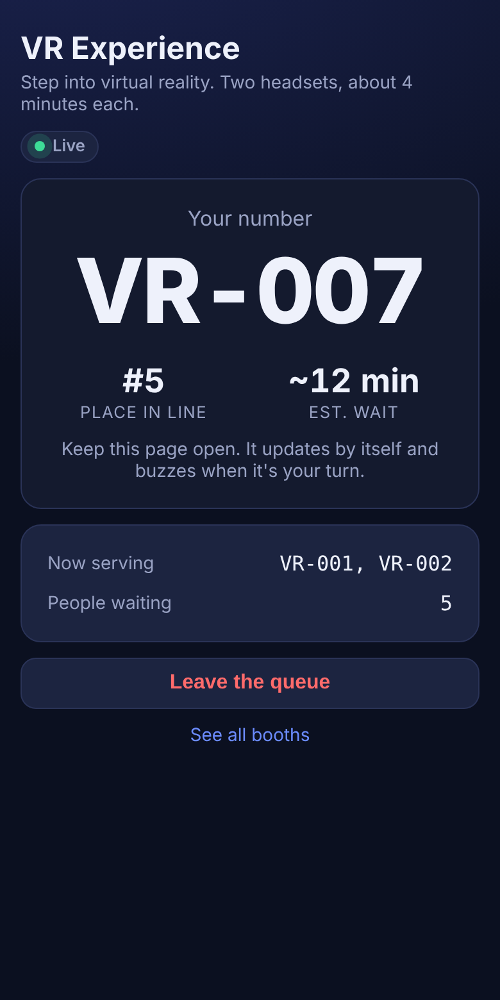
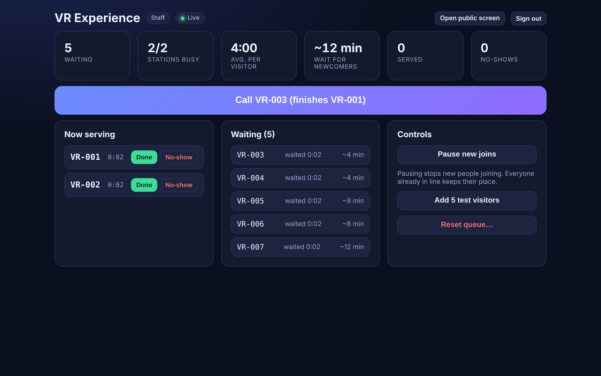
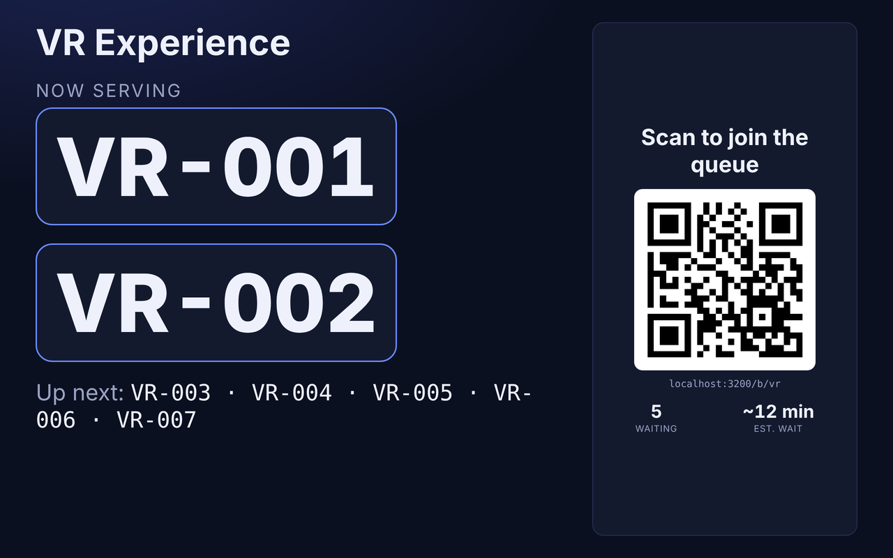

# Queuely: event queues with live wait times

[](https://github.com/gitgud9/queuely/actions/workflows/ci.yml)

Visitors scan a booth's QR code, join the queue on their phone, and watch their **place in line** and **estimated wait** update live. Their phone buzzes when it's their turn. Staff run the line from a dashboard (call next, mark no-shows, pause), and a big **"Now serving"** screen at the booth shows who's up. It supports several booths at once, each with its own number of stations (for example 2 VR headsets or 4 consoles).

Built as a portfolio project inspired by the queue systems used at large public events with gaming and VR booths.

| Visitor's phone | Staff Portal |
| --- | --- |
|  |  |

**Public "Now serving" screen**



**Try it:** visitors start on the home page (Join queue, Public screen, QR codes). Staff click **Staff Portal** and enter the PIN (`1234` unless `STAFF_PIN` is set). In demo mode the dashboard also has an "Add 5 test visitors" button.

## Features

- **Join by QR code.** Every booth has a URL (`/b/vr`) and a QR code on the public screen and home page. No app or sign-up.
- **Live updates everywhere.** Visitor, staff and display screens update within a fraction of a second when anything changes.
- **Wait estimates that learn.** The estimate starts from the booth's expected time per visitor, then adjusts to how long visitors actually take.
- **Multi-station booths.** A booth with 2 headsets serves 2 people at once, and the estimate accounts for that.
- **Separate guest and staff areas.** Guests only ever see Join queue, the public screen and QR codes. Staff use one **Staff Portal** behind a PIN, with a tab per booth.
- **Staff tools.** Call next, Done, No-show (and "turned up late, serve now"), pause new joins, reset.
- **AI event assistant.** Visitors can ask "Which queue is shortest?" or "What's on at 3pm?" in a chat. Claude answers from the event info and checks the live queues through tool calls (see [AI event assistant](#ai-event-assistant)).
- **Built for real phones.** The ticket survives a page reload, the phone vibrates and the tab title changes when you're called, and the page re-syncs when you unlock your phone.

## Pages

| Path | Who it's for |
| --- | --- |
| `/` | Guest home: every booth with live waiting count, QR code, Join and Public screen links |
| `/b/[booth]` | Visitor: join, see your number, place and wait, leave |
| `/staff` | Staff Portal: PIN first, then one dashboard with a tab per booth (`/staff?booth=vr`). Old `/staff/<booth>` links redirect here |
| `/assistant` | Chat with the AI event assistant: live wait times, directions, schedule |
| `/display/[booth]` | Big screen next to the booth: now serving, up next, QR to join |

## Architecture

```
 Visitor phone ─┐                       ┌─────────────────────────┐
 Staff tablet  ─┼── HTTP actions ──────▶│ Next.js API routes       │
 Public screen ─┘   (join/call/skip)    │  • check PIN / token     │
       ▲                                │  • run pure queue logic  │
       │                                │  • atomic write          │
       │                                └───────────┬─────────────┘
       │                                            ▼
       └──── live state push ◀──────── Postgres (Supabase) row per booth
             (Supabase Realtime,                    or in-memory store
              or SSE when local)                    for local dev/tests
```

- **Next.js (App Router) + TypeScript.** One codebase for the UI and the API, and it deploys to Vercel for free.
- **Supabase (Postgres + Realtime)** in production. Browsers subscribe to changes on their booth's row.
- **In-memory store + Server-Sent Events** when no Supabase keys are set. You can run the whole app and all tests with zero setup.

## Design choices (and why)

### 1. The queue logic is pure functions
All the rules live in [`src/lib/queue.ts`](src/lib/queue.ts) as functions shaped like `(state, action, now) → newState`. They don't touch the database, the clock or the network.
- **Easy to test.** The unit tests feed in a state and a fake time and check the result, with no database or mocks.
- **The same code runs on the server and in the browser.** The visitor's phone computes its own position and wait from the same functions the server uses, so they can never disagree.

### 2. One document per booth, saved with optimistic concurrency
Each booth's whole queue is a single JSON document (`booths.state`) with a `version` number. A write looks like this:
```
read state + version  →  newState = applyAction(state)  →
UPDATE booths SET state = newState, version = version + 1 WHERE id = ? AND version = <version I read>
```
If two staff members press "Call next" at the same moment, or 40 people join in the same second, only one write matches the version. The others re-read and retry. **No ticket number is ever handed out twice**, and an end-to-end test checks this with 40 joins at once.

I picked this over a `tickets` table with row locks or SQL functions because it keeps every rule in TypeScript, in one place, under test. The trade-off is that very busy booths get more retries. That's fine at booth scale (tens of joins a minute). For thousands per second, I'd move to a SQL function or a queue service. Finished tickets are trimmed to the last 30 so the document stays small.

`version` is just a change counter: it goes up by 1 every time anything happens at that booth (someone joins, leaves, is called, and so on). It isn't a guest count. For people reading the table in Supabase, Postgres also keeps four **generated columns** worked out from the JSON on every write: `waiting_guests`, `done_guests`, `no_show_guests` and `total_guests` (all tickets handed out since the last reset). Generated columns can't drift out of sync with the real state, because nobody writes them by hand.

### 3. Push the state, don't poll for it
Every change produces a new state row, and Supabase Realtime pushes that row to every subscribed screen. Screens don't need a second request, so updates show up almost instantly. As a safety net, each screen also refetches every 20 seconds and whenever the tab becomes visible again, because phones often drop WebSocket connections when the screen locks. Each screen only accepts a state with a **higher `version`** than the one it has, so a slow response can't overwrite a newer update.

### 4. Wait-time estimate
```
free slots = stations − people being served
ahead      = your position − free slots          (≤ 0 → "any moment now")
wait       = ceil(ahead / stations) × avg time per visitor − time the longest session has already run
```
The **average time per visitor is learned** with an exponential moving average (30% weight on each new visit). Each new visit time is clamped to between 0.2× and 5× the booth's default, so one visitor who stays for an hour, or a mis-tap that ends a session after 2 seconds, can't wreck everyone's estimate. No-shows don't count toward the average.

### 5. Tickets without accounts
Visitors shouldn't have to sign up to join a 5-minute queue. When you join, the server gives you a token, `HMAC(secret, booth:number:joinedAt)`, which your phone keeps in `localStorage`. Only the server can produce that token, so only you can leave your place in line. Because **no secrets are stored in the database**, the whole queue state (numbers and times only, no personal data) can be public and pushed to everyone in real time. `joinedAt` is part of the token, so a stale ticket from before a queue reset can't touch a new ticket with the same number.

### 6. One button for the common case
On a one-station booth, "Call next" finishes the current visitor and calls the next one in one tap. On multi-station booths it fills free stations first. Staff are busy, so the main action should take one press.

## AI event assistant

`/assistant` is a chat page where visitors ask questions in plain English. It is linked from the guest home page.

| Visitor asks | What happens |
| --- | --- |
| "Which queue is shortest right now?" | Claude calls `get_live_queues`, gets every booth's live wait, and recommends the quickest open one with its location |
| "Where's the VR booth?" | Answered straight from the event info in the system prompt, no tool needed |
| "What's on at 3pm?" | Claude calls `get_schedule`, which also returns the current event time, so "now" and "next" are correct |
| "Write my homework" | Politely declined: it only talks about the festival |

```
 Browser ──POST /api/chat {messages}──▶ API route ──▶ Claude (Messages API)
                                         ▲     │        │ "I need get_live_queues"
                                         │     ▼        ▼
                                         │   runTool() reads the same queue store
                                         └── tool_result goes back ──▶ Claude writes the reply
```

### Design choices (and why)

1. **Tool use instead of pasting the data into the prompt.** Wait times change every few seconds, so the model has to fetch them when it needs them. Tools also mean the model never invents numbers: the system prompt tells it to always call `get_live_queues` for wait questions. Static info (places, FAQ) is small and never changes, so it goes straight into the system prompt, which is also prompt-cached.
2. **The tools reuse Queuely's own code.** `get_live_queues` calls the same store and the same `estimateWaitSec` function as the home page, so the assistant and the screens can never disagree. The tools are read-only: the model can look at queues but cannot join, skip or reset anything.
3. **I wrote the tool loop myself** ([`src/lib/assistant/agent.ts`](src/lib/assistant/agent.ts), about 60 lines): send the chat, and while Claude answers with `tool_use`, run the tools and send all the results back in one message. It has a hard limit of 5 tool rounds so a confused model can't loop forever and run up a bill, and a tool error goes back to Claude as an error result instead of crashing the request.
4. **The browser holds the chat history, the server checks it.** The server is stateless (good for Vercel), and `parseHistory` rejects anything odd before it costs money: at most 20 messages and 1000 characters each, and only `user` and `assistant` roles, so nobody can inject a fake system message.
5. **The API key stays on the server.** Only the `/api/chat` route talks to Anthropic. Without a key, the page still loads and the API answers with a clear "not set up yet" message.
6. **Model settings.** It uses `claude-opus-5-5` (change it with the `ASSISTANT_MODEL` variable) at **low effort**, because short chat answers don't need deep reasoning, which keeps replies fast and cheap. It also turns on server-side **fallbacks**: if the model declines a request, Anthropic retries it on a fallback model inside the same call.
7. **Tested without calling the real API.** The unit tests pass a fake Claude that plays back scripted responses, so they check the loop itself (tool results sent back, parallel calls, errors, the round limit, refusals) for free and the same way every time. The browser test stubs `/api/chat` and checks the chat page.

**What I'd add next:** stream the reply word by word, let the assistant join a queue for the visitor (with a confirm button, since that changes data), answer in Malay, Chinese and Tamil, and log questions it couldn't answer to improve the event info.

## Running it

```bash
npm install
npm run dev          # http://localhost:3000, in-memory mode, staff PIN 1234
```

### Tests
```bash
npm test             # unit tests: queue rules, wait estimates, tokens, store, assistant tools and loop
npm run test:e2e     # browser tests (Playwright), builds and starts the app
```
The end-to-end tests open **separate browser contexts as separate phones**. Three visitors join, staff call and skip, one visitor leaves, and staff pause and resume. The tests check that every visitor's screen, the staff dashboard and the public display update live without reloading. They also cover a two-station booth, a rush of 40 simultaneous joins, the PIN and ticket-token security, and that guests see no staff links while the Staff Portal stays locked until the right PIN is entered.

### Deploying (Vercel + Supabase, both free)
1. Create a Supabase project. In **SQL editor**, run [`supabase/schema.sql`](supabase/schema.sql).
2. Import this repo in Vercel and set these environment variables:
   | Variable | Value |
   | --- | --- |
   | `NEXT_PUBLIC_SUPABASE_URL` | Supabase → Project settings → Data API → Project URL |
   | `NEXT_PUBLIC_SUPABASE_ANON_KEY` | the publishable key (`sb_publishable_…`, or the legacy `anon` key) |
   | `SUPABASE_SERVICE_ROLE_KEY` | the secret key (`sb_secret_…`, or the legacy `service_role` key). Server only, never exposed |
   | `TICKET_SECRET` | any long random string |
   | `STAFF_PIN` | the PIN staff will use (leave unset to keep the demo PIN 1234) |
   | `ANTHROPIC_API_KEY` | your key from console.anthropic.com → API keys. Needed for the `/assistant` chat. Server only |
   | `ASSISTANT_MODEL` | optional, defaults to `claude-opus-5-5` |
   | `NEXT_PUBLIC_REPO_URL` | link to the repo (optional, defaults to github.com/gitgud9/queuely) |
3. Deploy. The booths (VR, Gaming, Photo) are created automatically on first load. Edit `src/lib/booths.ts` to change them.

## What I'd add next
- Text or push notification when you're 2 places away, so visitors can walk around instead of watching their phone.
- Per-staff accounts (Supabase Auth) instead of one shared PIN, plus rate limiting on joins.
- An analytics page: peak hours, average wait versus estimated wait, no-show rate per booth.
- Let visitors join several booths and get a suggested order, using the live wait times.

## Project layout
```
src/lib/queue.ts          pure queue rules + wait estimate
src/lib/store/            memory and Supabase stores behind one interface
src/lib/token.ts          ticket tokens and staff PIN check
src/lib/client/useBooth.ts live state hook (Realtime or SSE, plus fallbacks)
src/lib/assistant/        AI assistant: event info, tools, tool-use loop
src/app/b, staff, display, assistant   the pages
src/app/api/              HTTP actions
tests/unit, tests/e2e     Vitest and Playwright
```
